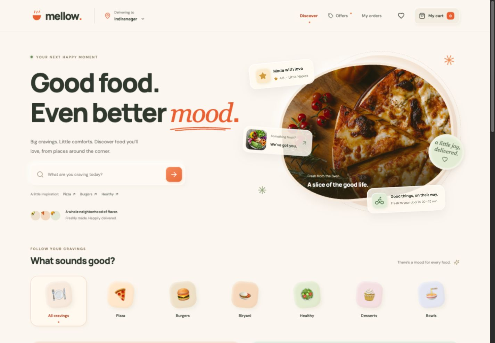

# Mellow — Good food. Good mood.

**Live website:** https://mellow-food-delivery-app.netlify.app

**Source:** https://github.com/rasinenitharunchowdary-cmyk/mellow-food-delivery

A complete food delivery frontend built with React, Vite, Tailwind CSS, React Router, Context API and Framer Motion. The design combines softly sculpted clay surfaces, frosted glass, warm peach and sage colors, food photography and responsive layouts.

This is a **frontend demonstration**. Restaurants, menus, ratings, checkout and tracking are demo data. No restaurant receives an order and no real payment is collected. Use fictional contact details. Cart and order data remain in your browser’s LocalStorage.



**Submission evidence:** [QA results](docs/QA.md) · [EOD update](docs/EOD_UPDATE_2026-10-18.md) · [Desktop / tablet / mobile screenshots](docs/screenshots/)

## Quick start

Use Node.js 22 or newer and npm.

```sh
npm ci
npm run dev
```

Open `http://localhost:5173`. No API keys, environment variables, database or backend are required.

```sh
npm test         # 20 pricing, validation, customization and persistence tests
npm run build   # creates dist/
npm run preview # serves the production build
```

## Features

- Restaurant discovery with live text search, cuisine categories, vegetarian/rating/delivery filters and four sort options.
- Six fictional restaurants and 35 menu items, with menu search and category/dietary filters.
- Dish customization: regular/large portions, optional extras, kitchen notes and quantities.
- One restaurant per cart, with explicit confirmation before replacing a different restaurant’s items.
- Separate cart lines for different customizations; matching lines merge, capped at 20 units each.
- Cart drawer, full cart page, quantity controls, removal, calculated fees, tax and coupon discounts.
- Saved restaurants, neighborhood selection, cart, coupon and order history persist across reloads.
- Checkout with name, Indian mobile number, address and Bengaluru pincode validation, inline errors and focus on the first error.
- Demo cash-on-delivery checkout, an immutable order snapshot and unique confirmation reference.
- Four-stage tracking: confirmed immediately, preparation after 45 seconds, en route after 2 minutes, delivered after 4 minutes. A clearly labelled preview control advances the simulated status.
- Order history, status persistence, order recap and reorder with cart replacement confirmation.
- Desktop, tablet and mobile layouts, animated interactions, keyboard focus indicators, skip link, labelled controls, focus-trapped dialogs, Escape dismissal and reduced-motion support.
- Friendly empty states, unavailable routes and defensive loading of saved cart data.

## Routes

| Route             | Purpose                                          |
| ----------------- | ------------------------------------------------ |
| `/`               | Home, search, categories and restaurant listings |
| `/restaurant/:id` | Restaurant details, menu and customization       |
| `/favorites`      | Saved restaurants                                |
| `/offers`         | Coupon codes and terms                           |
| `/cart`           | Items, quantities, coupon and price breakdown    |
| `/checkout`       | Delivery details and demo checkout               |
| `/order/:id`      | Order confirmation, timeline and recap           |
| `/orders`         | Persistent order history and reorder             |

## Coupon and pricing rules

| Code       | Benefit                      | Eligibility                                    |
| ---------- | ---------------------------- | ---------------------------------------------- |
| `MELLOW20` | 20% off food, capped at ₹150 | Food subtotal at least ₹299                    |
| `FREEDEL`  | Waives the ₹35 delivery fee  | Food subtotal at least ₹399                    |
| `HELLO100` | ₹100 off food                | First saved order; food subtotal at least ₹499 |

One coupon applies per order. Delivery costs ₹35; the platform fee is ₹5. Demo food tax is 5% of the food subtotal after discount, rounded to the nearest rupee. Tax rules and prices are illustrative, not tax advice. Coupon eligibility is rechecked after every quantity change and before checkout. Empty carts carry no fees. Clearing browser storage resets the demo’s first-order eligibility.

## Structure and state

```text
src/
  components/   shared layout, restaurant cards, dialogs, customization, cart and bill
  context/      reducer-based StoreProvider and LocalStorage persistence
  data/         restaurant/menu catalog and customization options
  lib/          pure pricing, validation, status and storage logic, plus unit tests
  pages/        home, restaurant, offers, cart, checkout, tracking and history
  main.jsx      application providers, routes, error boundary and scroll handling
  styles.css    design tokens, clay/glass components and responsive layouts
public/
  images/       local food photography
  fonts/        self-hosted typefaces and their OFL license files
tests/          reproducible Playwright interaction tests
docs/           implementation plan, EOD update, QA report and screenshots
```

Context API and `useReducer` own the shared cart, orders, favorites, location and coupon. Page-level state owns ephemeral filters and forms. Orders copy the cart and totals at placement so subsequent cart changes do not change past orders. LocalStorage key: `mellow.v1`. If storage is unavailable, the app continues in memory and displays a notice.

## Deploy

### Netlify

Import the GitHub repository into Netlify. The included `netlify.toml` sets Node 22, `npm run build`, `dist` and the SPA fallback. Deploy the `main` branch. The `_redirects` file also supports manual uploads of the built folder.

### Vercel

Import the repository, choose Vite, use `npm run build` and output directory `dist`. The included `vercel.json` supports direct navigation to React Router routes.

No secrets or environment variables are needed. Never add real payment or privileged service credentials to frontend code. A production service would require server-side pricing, order/payment processing, identity, operational restaurant data and real delivery updates.

## Browser tests

```sh
npx playwright install chromium
npm run test:e2e
# To test an already deployed site:
BASE_URL=https://YOUR-SITE.netlify.app npm run test:e2e
```

The test configuration covers desktop (1440×1000), tablet (768×1024) and mobile (390×844). It checks search/favorites, a complete customized order with coupon and validation, cart persistence, tracking, reorder, restaurant switching and horizontal overflow. See `docs/QA.md` for the checks actually executed for this handoff; supplying a test does not imply it was run.

## Assets and attribution

Food photographs are sourced from [Unsplash](https://unsplash.com) and stored locally. Image source IDs: `photo-1513104890138-7c749659a591` (pizza), `photo-1568901346375-23c9450c58cd` (burger), `photo-1512621776951-a57141f2eefd` (salad), `photo-1563379091339-03b21ab4a4f8` (biryani), `photo-1578985545062-69928b1d9587` (cake), `photo-1476224203421-9ac39bcb3327` (bowl). Menu images are illustrative and reused by food category.

[Manrope](https://fonts.google.com/specimen/Manrope) and [DM Sans](https://fonts.google.com/specimen/DM+Sans) are self-hosted; their SIL Open Font License files are included in `public/fonts/`. Icons are from Lucide. The bowl logo, bag illustration and tracking scene are project-native SVG/CSS artwork. Native platform emoji render the category food illustrations.

## Maintaining the project

Add restaurants and menus in `src/data/restaurants.js`. Keep pricing and eligibility logic in `src/lib/commerce.js` and update its tests when rules change. Reuse the shared dialog, bill, quantity and cart components. Run unit tests, the build and relevant browser checks before publishing.
